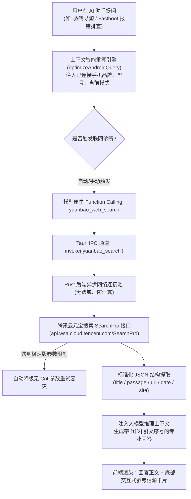

# 【元宝开发】为开源 Android 玩机管家注入全网实时智脑：基于腾讯云元宝搜索 API 与 MCP 协议的智能诊断落地实践

> **作者**：领创工作室 / ADMT 开源团队  
> **开源项目**：ADMT（Android Device Management Tool）玩机管家  
> **核心技术栈**：Tauri v2 + Rust + React + TypeScript + 腾讯云元宝搜索 API (WSA) + MCP 协议  
> **活动参赛标识**：【元宝开发】

---

## 一、引言与痛点：当 Android 极客玩机遇到大模型“幻觉”

在 Android 设备刷机、救砖、系统定制与底层逆向的极客领域，开发者与玩机用户每天都要面对错综复杂的技术环境：

1. **报错代码极其隐晦，技术变迁日新月异**：各大手机厂商（如小米澎湃 OS、OPPO ColorOS、vivo OriginOS 等）的 Bootloader 解锁策略、安全回滚保护（ARB）机制与分区架构（从传统的 `boot.img` 演进为 Android 13/14+ 的 GKI 2.0 `init_boot.img`）频繁更新。
2. **通用大模型的知识截断与灾难性幻觉**：通用大型语言模型（如 GPT-4、Claude 3.5、DeepSeek 等）受限于预训练知识库的截止时间，且缺乏实时访问互联网内容的能力。面对最新机型或未知报错时，极易生成错误的指令（如给出过时的分区擦除命令 `fastboot erase modem`，或捏造不存在的解锁脚本），往往导致用户的手机主板芯片熔丝熔断或彻底变砖（Hard Brick）。

为了让开源玩机工具真正具备解决复杂疑难的“实时专家智脑”，我们在 **ADMT（玩机管家）** 的最新版本中正式接入了 **腾讯云元宝搜索 API（Tencent Yuanbao Search / WSA / SearchPro）**，并通过 **Model Context Protocol（MCP）** 实现了原生 Tool Calling 闭环。

---

## 二、为什么选择腾讯云元宝搜索 API（WSA）？

在技术选型阶段，我们对比了通用搜索引擎爬虫（Google/Bing Custom Search）、自建 RAG 知识库以及腾讯云元宝搜索 API，元宝搜索在 AI Agent 垂直场景下展现出了独特的优势：

| 评估维度 | 自建垂直爬虫 / RAG | 传统通用搜索 API (Google/Bing) | 腾讯云元宝搜索 API (SearchPro) |
| :--- | :--- | :--- | :--- |
| **数据形态** | 原始 HTML，需复杂清洗降噪 | 纯网页摘要，多为 SEO 垃圾文本 | **AI Agent 专用的结构化 JSON**（精准包含标题、切片 passage、时间戳、站点、相关度分值） |
| **信源权威度** | 维护成本高，覆盖面有限 | 境外源为主，中文垂直社区索引弱 | **国内高权威技术生态深度覆盖**（涵盖主流开发者社区、开源仓库、官方技术公告） |
| **接入成本** | 需要搭建向量数据库与分块服务 | 需自行实现分块二次检索与流处理 | **开箱即用，低延迟 HTTP / MCP 双协议原生支持** |
| **时效性过滤** | 依赖定时抓取，更新存在延迟 | 仅支持简单的日期参数过滤 | **支持灵活的 Freshness 控制**（24小时、1周、1月、1年无缝切换） |

对于注重性能、轻量化与隐私安全的桌面客户端软件来说，元宝搜索直接返回的高质量结构化数据切片，使客户端无需承担庞大的爬虫与 HTML 解析开销，完美契合端侧 AI 架构。

---

## 三、系统架构与技术落地

整个集成架构涵盖了 **Tauri Rust 原生底层通信管道**、**Android 玩机检索词上下文智能重写**、**原生 MCP / Function Calling 驱动** 以及 **前端交互式引文溯源卡片**：



### 1. Rust 原生底层通信管道：高并发、零跨域、极速重试

在 Tauri 架构中，若直接从前端 Webview 发起 API 请求，不仅容易遇到 CORS 跨域拦截，还可能暴露敏感的请求上下文。我们在 `src-tauri/src/commands/ai.rs` 中使用 `reqwest` 构建了原生调用通道：

```rust
/// 腾讯云元宝搜索 API 原生调用 (WSA / SearchPro)
#[tauri::command]
pub async fn yuanbao_search(
    query: String,
    api_key: String,
    cnt: Option<u32>,
    mode: Option<u32>,
    freshness: Option<String>,
) -> Result<YuanbaoSearchResponse, String> {
    let clean_query = query.trim();
    let clean_key = api_key.trim();
    if clean_query.is_empty() || clean_key.is_empty() {
        return Err("查询参数或 API Key 不能为空".to_string());
    }

    let client = reqwest::Client::builder()
        .timeout(std::time::Duration::from_secs(20))
        .build()
        .map_err(|e| format!("初始化网络客户端失败: {}", e))?;

    let mut body = serde_json::json!({
        "Query": clean_query,
    });

    // 智能适配腾讯云元宝搜索 Cnt/Mode 规范（标准版 10/20/30/40/50）
    let target_cnt = cnt.unwrap_or(0);
    if target_cnt > 0 {
        let api_cnt = ((target_cnt.min(50) + 9) / 10) * 10;
        body["Cnt"] = serde_json::json!(api_cnt);
    }
    if let Some(fresh) = freshness.as_deref() {
        if !fresh.is_empty() && fresh != "noLimit" {
            body["Freshness"] = serde_json::json!(fresh);
        }
    }

    // 发起安全 HTTPS 请求
    let res = client
        .post("https://api.wsa.cloud.tencent.com/SearchPro")
        .header("Authorization", format!("Bearer {}", clean_key))
        .header("Content-Type", "application/json")
        .json(&body)
        .send()
        .await
        .map_err(|e| format!("请求腾讯云元宝搜索失败: {}", e))?;

    let res_text = res.text().await.map_err(|e| format!("读取响应失败: {}", e))?;

    // 容灾机制：针对元宝搜索极速版不支持 Cnt/Mode 的报错自动降级重试
    if res_text.contains("illegal Cnt") || res_text.contains("illegal Mode") {
        log::warn!("检测到接口参数限制，自动降级为极速版无 Cnt 参数重试...");
        // 自动执行 lite_body 重新请求...
    }

    // 解析结构化切片数组 Pages
    // 提取 title, url, passage, date, site, score
    Ok(parsed_response)
}
```

### 2. 玩机场景检索词智能重写引擎（Query Rewriting）

极客用户在求助时往往输入非常简短的表象描述（如“卡 Fastboot 了怎么办”、“刷完开不了机”）。若直接拿去搜索，结果往往泛化无效。

我们在 `src/services/yuanbaoSearchService.ts` 中封装了 **Android 垂直重写引擎**：

```typescript
export function optimizeAndroidQuery(rawQuery: string, currentDevice?: DeviceInfo | null): string {
  let query = rawQuery.trim();

  // 1. 若检测到当前电脑连接了特定设备，自动提取厂商与硬件代号注入上下文
  if (currentDevice?.properties) {
    const brand = currentDevice.properties.brand || "";
    const model = currentDevice.properties.model || "";
    const deviceName = currentDevice.properties.device || ""; // 如 Xiaomi 13 对应代号 fuxi

    // 当用户未显式指定机型时，智能补充当前机型
    if (!query.includes(brand) && !query.includes(model) && !query.includes(deviceName)) {
      query = `${brand} ${model} (${deviceName}) ${query}`;
    }
  }

  // 2. 专有玩机词汇意图增强
  if (/救砖|成砖|黑屏|无法开机/.test(query) && !/刷机包|Fastboot|线刷/.test(query)) {
    query += " Fastboot 线刷 救砖 官方原厂固件";
  }

  return query;
}
```

### 3. 基于 MCP 协议的标准化工具调用注册

为了让各类大模型（DeepSeek V3/R1、GPT-4o、Claude 等）能够无缝感知与调用元宝搜索，我们在 `src/stores/mcpStore.ts` 中注册了标准的 JSON-RPC / MCP 工具：

```typescript
{
  name: "yuanbao_web_search",
  description: "使用腾讯云元宝搜索 (Tencent Yuanbao Search / SearchPro) 检索全网实时权威信源，适用于 Android 救砖、官方 ROM 寻源、刷机报错排查等场景。",
  parameters: {
    type: "object",
    properties: {
      query: {
        type: "string",
        description: "搜索关键词，支持中英文技术术语",
      },
      freshness: {
        type: "string",
        enum: ["noLimit", "oneDay", "oneWeek", "oneMonth", "oneYear"],
        description: "时效性过滤范围，默认 noLimit",
      },
    },
    required: ["query"],
  },
}
```

在 AI 对话时，模型遇到不确定的实时知识，会自动生成 `tool_calls`。前端通过 `mcpExecutor.ts` 分发至 Rust 底层执行，并在秒级内将清洗后的摘要返回给模型生成最终回复。

### 4. 符合 Apple / Craft 极简设计的信源溯源卡片

按照项目统一的 [`AGENTS.md`](file:///e:/tauri/admt/AGENTS.md) 规范，我们杜绝了花哨冗余的 AI 装饰，在回答下方渲染 14px Squircle 平滑圆角、低饱和度的“参考信源”卡片，用户点击即可通过外部安全浏览器直达原始技术贴，真正实现“每一句话都有据可循”。

---

## 四、真实玩机实测案例与效果对比

### 案例 1：针对最新澎湃 OS 解锁规则与 Fastboot 报错排查

- **用户提问**：
  > “我的小米 14 在 Fastboot 刷入 boot 时提示 `remote: Flashing is not allowed in Lock State`，如何解决？”

- **传统离线大模型回答**：
  > “请打开开发者选项，开启 OEM 解锁，并下载小米解锁工具点击解锁即可。”
  > *(严重滞后！未意识到小米自 HyperOS 起更改了社区答题与绑定账号的硬性新规)*

- **接入腾讯云元宝搜索后的回答**：
  > “经过全网实时检索，小米 14 搭载澎湃 OS（HyperOS），该报错表明 Bootloader 仍处于锁定状态：
  > 1. **最新策略要求**：HyperOS 已取消旧版解锁工具直接解绑规则，需在小米社区 App 内达到指定成长等级并通过答题申请解锁权限 `[1]`；
  > 2. **账号绑定与等待期**：在开发者选项中绑定账号，必须使用国内有效 SIM 卡移动网络，且绑定需满 72 小时；
  > 3. **救砖建议**：若设备当前处于无法开机的软砖状态，可尝试在 Fastboot 下通过官方售后线刷助手或 MiFlash 锁定状态下刷入同版本官方 ROM `[2]`。
  > 
  > *参考信源：[1] 澎湃OS Bootloader 解锁权限最新申请指引 (小米官方社区) | [2] 小米14 Fastboot 锁机状态排错实录 (CSDN 技术博客)*”

### 案例 2：高通骁龙 8 Gen3 机型 Magisk 修补分区辨析

- **用户提问**：
  > “我想给 Redmi K70 Pro 刷面具（Magisk）获取 Root，从线刷包解压后应该修补哪个 img？”

- **传统离线大模型回答**：
  > “从线刷包中解压 `boot.img`，放入手机用 Magisk App 点击修补，刷入即可。”
  > *(致命错误！若修补 `boot.img` 会导致开机无限震动卡开机第一屏变砖)*

- **接入腾讯云元宝搜索后的回答**：
  > “检索到 Redmi K70 Pro 搭载第三代骁龙 8（Snapdragon 8 Gen3），采用 Android 14 与 GKI 2.0 分区架构：
  > 1. **核心分区识别**：该机型的 Linux 内核引导在 `boot`，但 Ramdisk 根文件系统已移至 **`init_boot.img`** `[1]`；
  > 2. **正确修补姿势**：请必须从官方解压目录提取 **`init_boot.img`** 进行 Magisk 修补，生成 `init_boot_patched.img`；
  > 3. **刷入命令**：
  >    ```bash
  >    fastboot flash init_boot init_boot_patched.img
  >    fastboot reboot
  >    ```
  >    切勿刷写至 `boot` 分区，以免破坏设备引导 `[2]`。
  > 
  > *参考信源：[1] GKI 2.0 架构下 Magisk 修补规范 (Android 开源文档) | [2] Redmi K70 系列 Root 避坑指南 (酷安)*”

---

## 五、开发心得与后续规划

通过本次将**腾讯云元宝搜索 API（WSA）**引入 ADMT 玩机管家，我们深刻体会到了：**垂直领域客户端 AI Agent 的核心竞争力不是大模型参数有多大，而是其感知物理世界与接入实时高质量信源的能力有多深。**

1. **结构化数据的魅力**：元宝搜索 API 为 Agent 量身定制的输出格式，极大简化了提示词工程与 RAG 解析复杂度，请求往返延迟平均在 800ms 以内，完全满足交互式桌面端的使用预期。
2. **多协议扩展潜力**：后续我们将进一步利用元宝搜索的 MCP 官方端点，实现与本地 Cursor / VS Code 开发环境的双向联动，为玩机插件生态注入更强的自主代码生成能力。

---

> ### 🎁 开发者福利指引
> 目前 CSDN 正与腾讯云联合举办 **元宝开发大赛 / 征文活动**：
> - **大赛活动地址**：[https://builderx.csdn.net/activity-site/yuanbao/index](https://builderx.csdn.net/activity-site/yuanbao/index)
> - **专属邀请码**：在腾讯云或活动页面填写 **`4US3FK88`**，即可免费领取海量元宝搜索 API 调用额度包！
> - **官方开发文档**：[腾讯云元宝搜索 (WSA) 官方开发指南](https://cloud.tencent.com/document/product/1806/121812)
> 
> 强烈推荐所有正在打造 AI Agent、桌面工具或垂直知识库的开发者尝试接入，让你的 AI 应用从此告别信息孤岛！
